<h1 align="center">TimeCuber</h1>

<p align="center"><strong>Cronómetro de speedcubing para iPhone</strong></p>

<p align="center">
  Entrena por sesión, guarda cada scramble y consulta tus tiempos y promedios.
  Elige entre la interfaz Clásica y Retro en Ajustes.
</p>

<p align="center">
  <a href="#galería">Galería</a> · <a href="#funciones">Funciones</a> · <a href="#primeros-pasos">Primeros pasos</a> · <a href="#compilar-en-xcode">Xcode</a> · <a href="informe.md">Informe técnico</a>
</p>

<p align="center">
  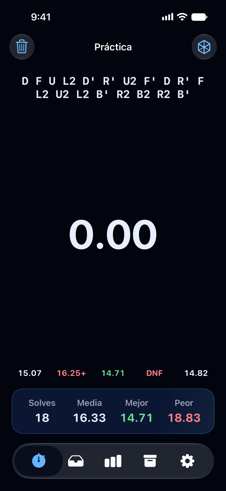
  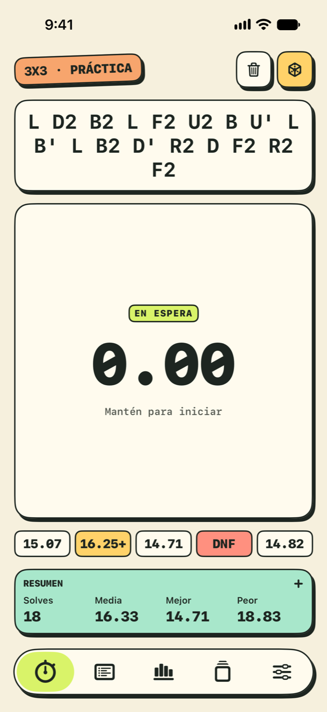
  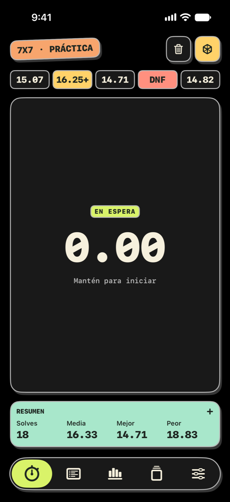
</p>
<p align="center"><sub>Clásico · Retro claro · Retro oscuro con el scramble oculto</sub></p>

## Galería

### Historial, estadísticas y sesiones

<p align="center">
  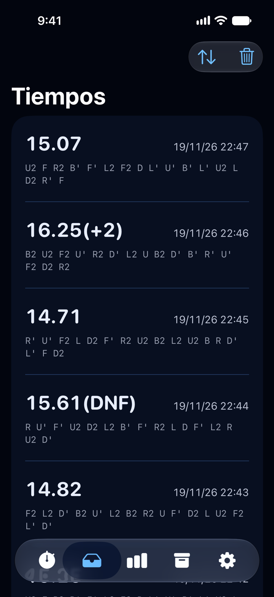
  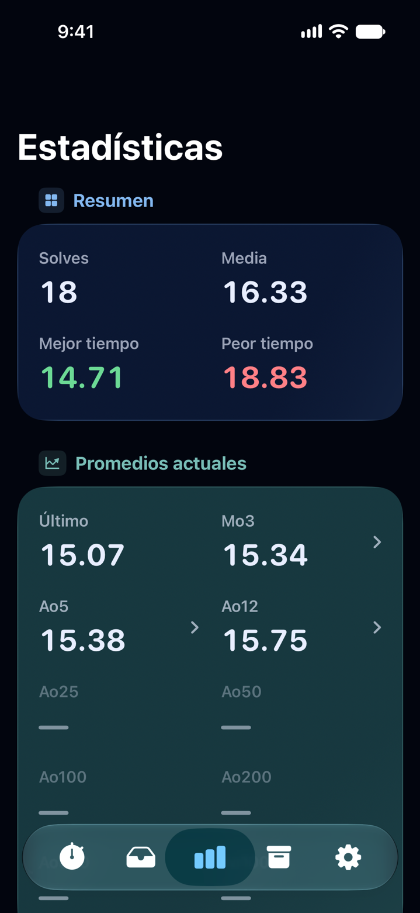
  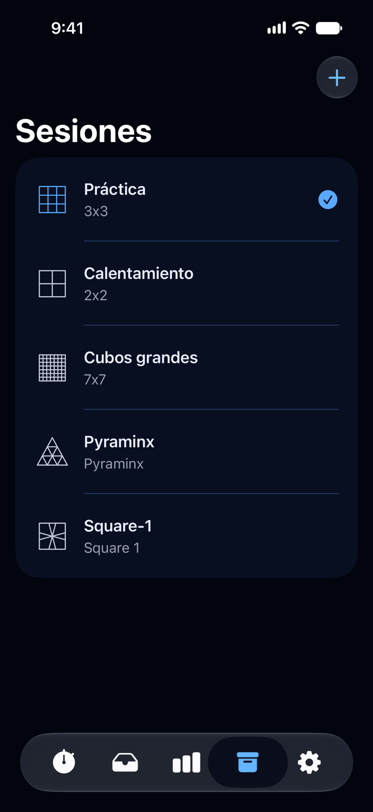
</p>

<p align="center">
  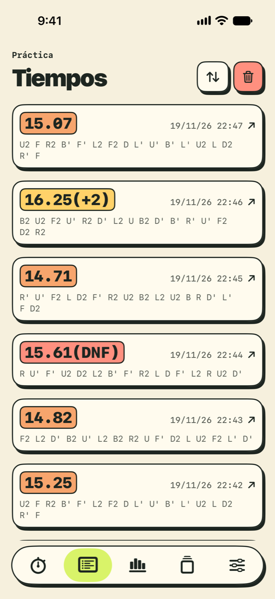
  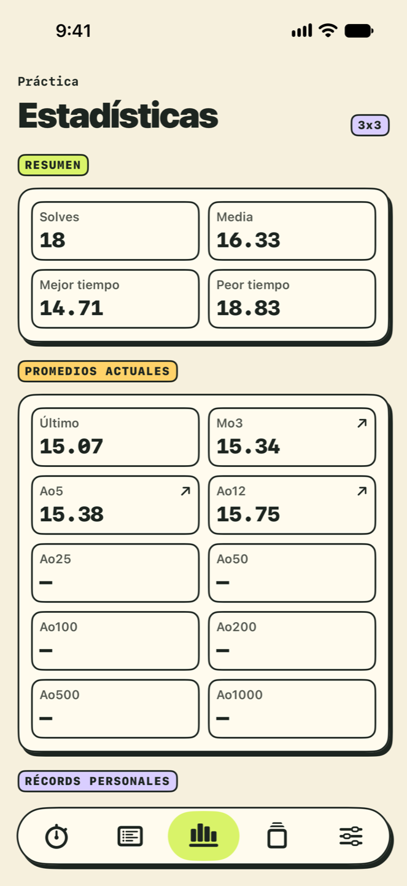
  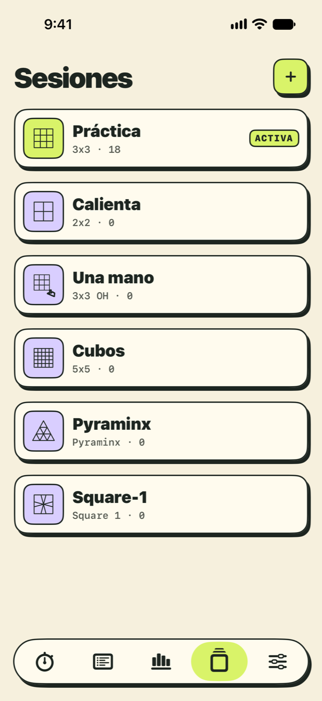
</p>

### Ajustes y diagramas

<p align="center">
  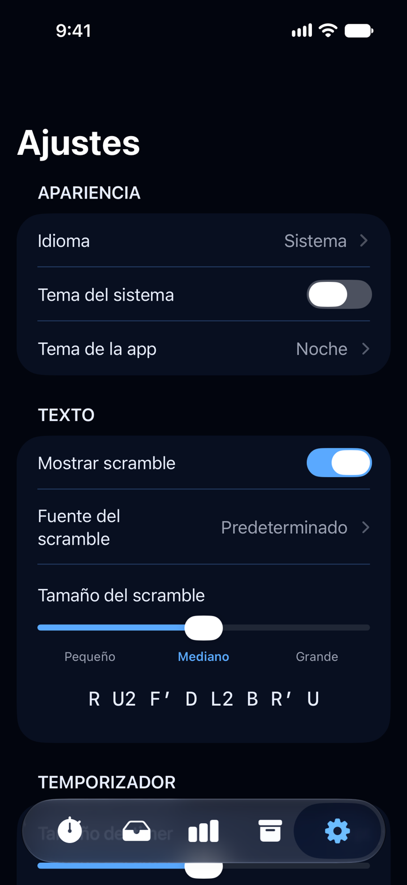
  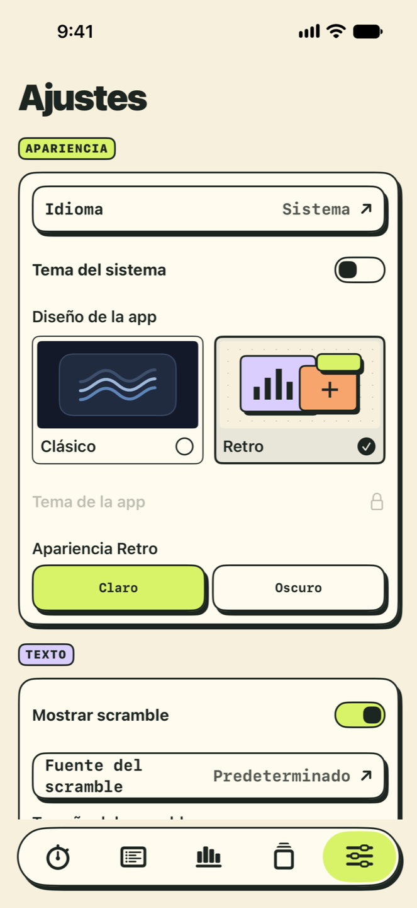
  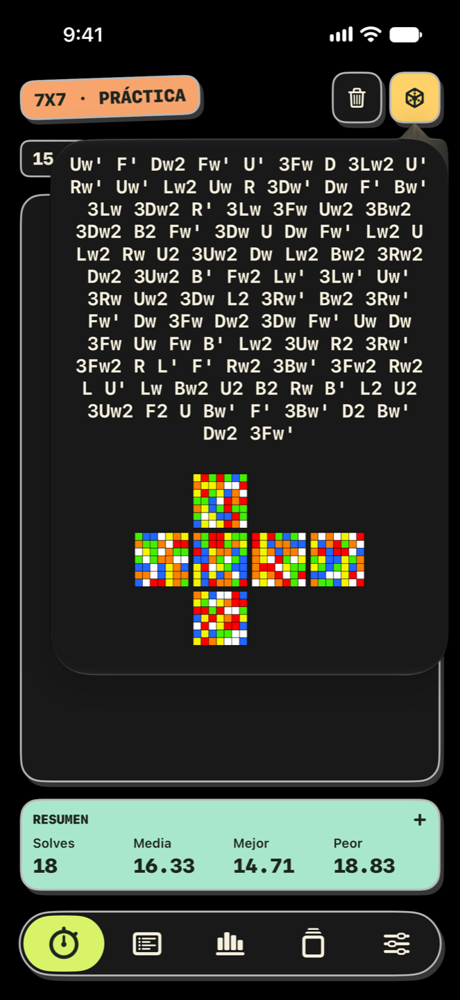
</p>

<details>
<summary>Ver diagramas y detalles de tiempos</summary>

<p align="center">
  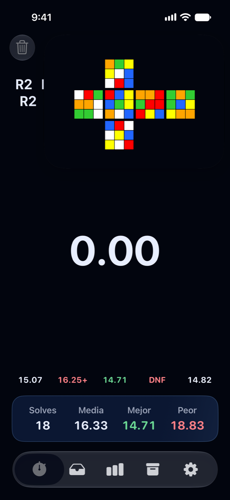
  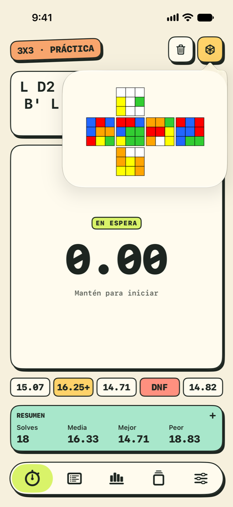
  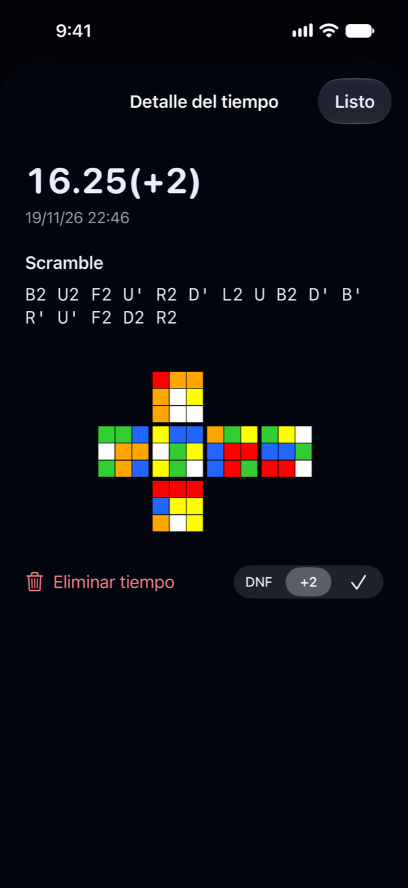
  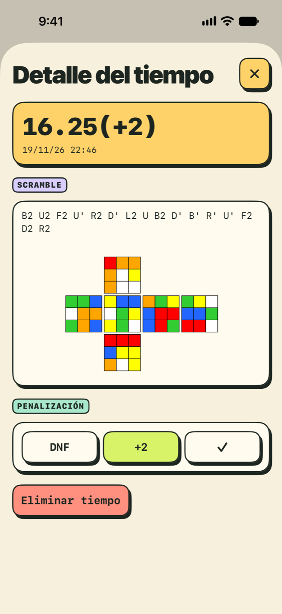
</p>

</details>

<details>
<summary>Ver récords, desglose de Mo3, creación de sesiones y fuentes</summary>

<p align="center">
  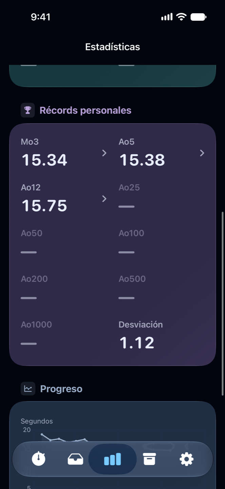
  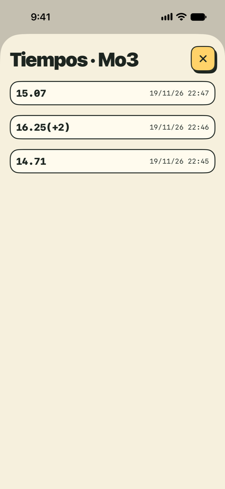
  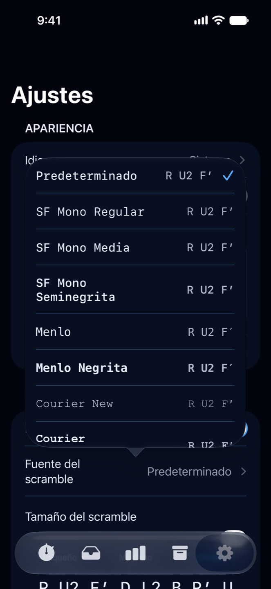
</p>

<p align="center">
  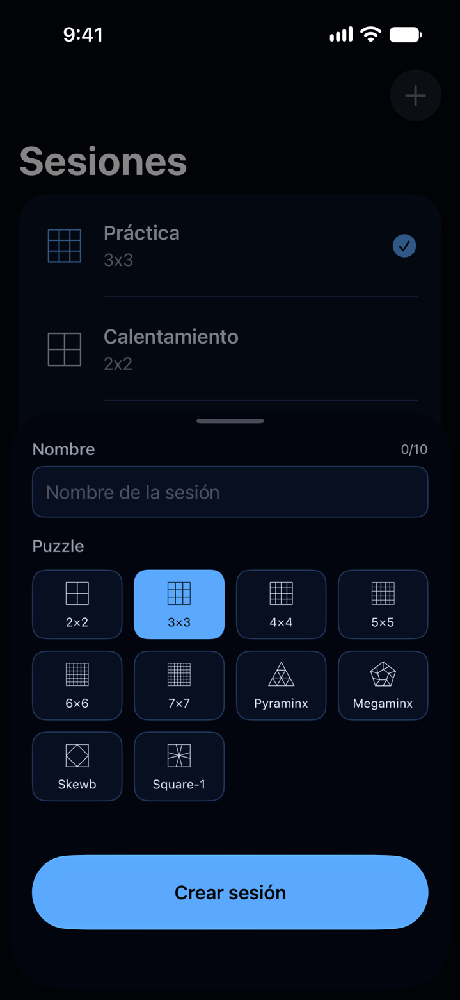
  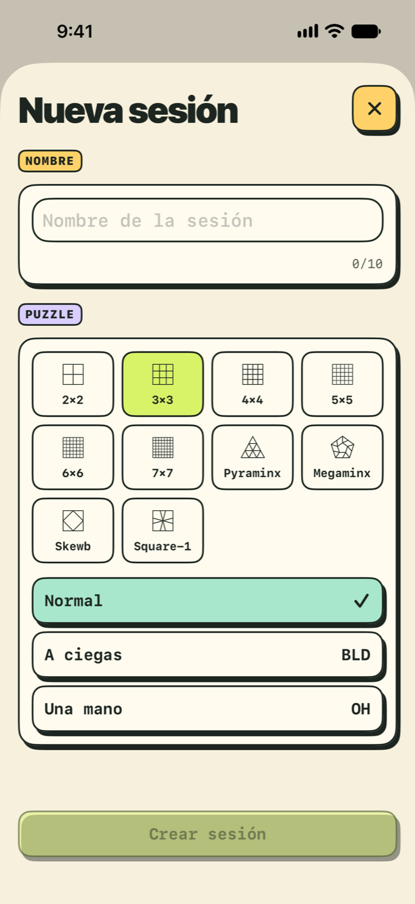
</p>

</details>

<sub>Capturas tomadas en un iPhone 15 simulado con datos de demostración.</sub>

## Funciones

| Función | Qué puedes hacer |
| --- | --- |
| **Cronómetro** | Inicia por toque o con una pulsación configurable de 0.3 a 1.5 s. Los dígitos cambian de color cuando puedes soltar para empezar. |
| **Inspección** | Inicia una cuenta ascendente con un toque y mantén pulsado para empezar la resolución. La app aplica **+2** a partir de 15 s y registra **DNF** al llegar a 17 s. |
| **Tiempo oculto** | Muestra `...` durante la resolución. La cuenta de inspección y el resultado final siguen visibles. |
| **Scrambles y diagramas** | Genera scrambles en el dispositivo para 14 categorías. Consulta su diagrama 2D desde el cronómetro o el detalle de una resolución. |
| **Scramble oculto** | Lleva los cinco tiempos recientes arriba y abre el texto del scramble junto al diagrama desde el botón del cubo. |
| **Historial y penalizaciones** | Ordena por fecha o duración y aplica **+2** o **DNF**. Cada resolución conserva el valor original, la fecha y el scramble. |
| **Estadísticas** | Consulta Mo3, Ao5 a Ao1000, récords, desviación y progreso. Abre un promedio para ver sus resoluciones. |
| **Sesiones** | Separa tus prácticas e historiales por sesión. Puedes crear sesiones con el mismo nombre y puzzle. |
| **Diseños y tipografías** | Elige Clásico con 16 temas o Retro con variantes clara y oscura. Ajusta el tamaño por separado y elige entre 15 fuentes para cada uno. |

## Primeros pasos

1. Abre **Sesiones** y elige una existente o crea una con **+**.
2. Lee el scramble en **Cronómetro**. El botón del cubo abre el diagrama.
3. Mantén pulsado hasta que cambie el color, suelta para empezar y toca para detener. También puedes configurar el inicio por toque. Si activas la inspección, el primer toque inicia la cuenta y el siguiente toque o pulsación inicia la resolución, según el ajuste elegido.
4. En **Tiempos**, toca una fila para abrir sus detalles y cambiar la penalización.
5. En **Ajustes → Apariencia → Diseño de la app**, toca la tarjeta **Clásico** o **Retro**. Ambos diseños usan tus mismas sesiones y tiempos.

## Compilar en Xcode

Usa Xcode con Swift 6 y el SDK de iOS 26 o posterior. El destino mínimo del proyecto es **iOS 17.4**. El framework incluido requiere un simulador ARM64 en Mac con Apple Silicon o un iPhone físico.

```bash
git clone https://github.com/rlaur205/rubik-timer-swift.git
cd rubik-timer-swift
open TimerV3.xcodeproj
```

Selecciona **TimerV3**, elige un iPhone y ejecuta con **⌘R**. Para un dispositivo físico, configura la firma del target en Xcode.

El [informe de TimeCuber](informe.md) documenta el uso, los cálculos, la persistencia y el mantenimiento. Las dependencias del motor y del visor figuran en los [avisos de terceros](THIRD-PARTY-NOTICES.md).
