# TimeCuber · Informe de uso y arquitectura

TimeCuber es un cronómetro de speedcubing para iPhone. Cada sesión reúne las resoluciones de una categoría, sus scrambles y sus estadísticas. La app genera los scrambles, dibuja los diagramas y guarda el historial en el dispositivo.

Las capturas se tomaron en un iPhone 15 simulado, con el tema **Noche** y datos de demostración.

## Contenido

- [Guía de uso](#guía-de-uso)
- [Penalizaciones y cálculos](#penalizaciones-y-cálculos)
- [Ajustes](#ajustes)
- [Arquitectura y recorrido de una resolución](#arquitectura-y-recorrido-de-una-resolución)
- [Modelo de datos y persistencia](#modelo-de-datos-y-persistencia)
- [Generación de scrambles y diagramas](#generación-de-scrambles-y-diagramas)
- [Compilación y mantenimiento](#compilación-y-mantenimiento)
- [Alcance y limitaciones actuales](#alcance-y-limitaciones-actuales)

## Guía de uso

### Cronómetro

<p align="center">
  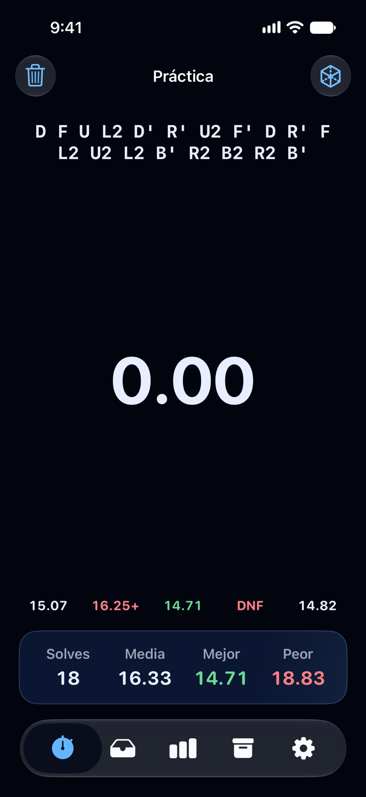
  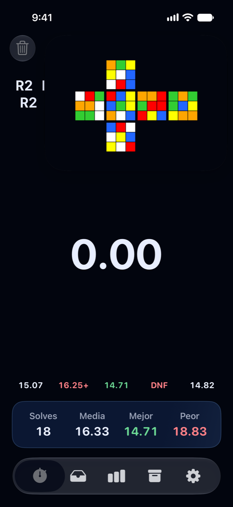
</p>

1. Selecciona una sesión. Su nombre aparece en la barra superior y su categoría determina el scramble.
2. Lee la secuencia de movimientos. El botón del cubo abre el diagrama del estado que debe tener el puzzle después de aplicar el scramble.
3. Con **Mantener para iniciar** activado, pulsa el área central hasta que los dígitos adopten el color de listo. Entonces suelta para empezar. Una pulsación breve deja el cronómetro en reposo. Si desactivas ese ajuste, un toque inicia la medición.
4. Toca de nuevo para detener el cronómetro. La resolución válida se guarda con el scramble aplicado y se prepara el siguiente.
   Si el scramble se está preparando, espera a que esté listo para iniciar. Si la generación falla, toca **Reintentar**.
5. Con el cronómetro detenido, desliza el dedo hacia abajo por el área de los dígitos para abrir las opciones **DNF**, **+2** y **Sin penalización**. La acción afecta al último tiempo de la sesión y está disponible cuando hay al menos una resolución.

La barra inferior muestra hasta cinco tiempos recientes. Al tocar el bloque de resumen puedes ver los promedios rápidos **Mo3**, **Ao5**, **Ao12** y **Ao50**. Durante una medición se ocultan el scramble, los controles de navegación y los indicadores de sesión. La papelera del cronómetro pide confirmación para eliminar el último tiempo.

Con **Mostrar scramble** desactivado, los últimos cinco tiempos aparecen arriba en ambos diseños. El botón del cubo abre un panel con el texto completo y el diagrama juntos.

### Tiempos

<p align="center">
  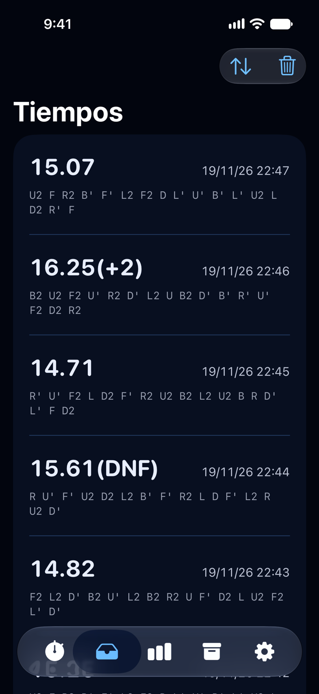
  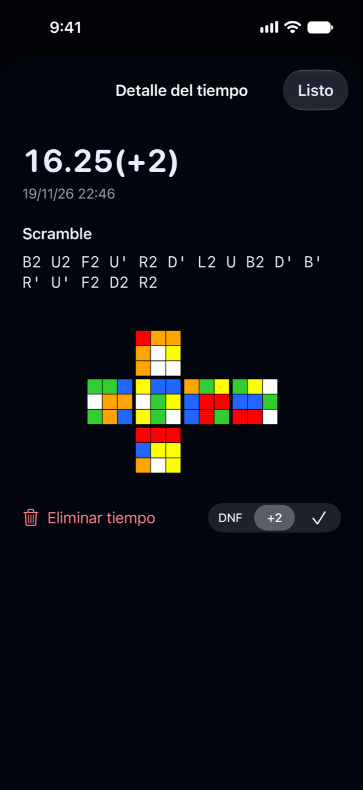
</p>

La lista muestra el resultado, la fecha y hora (`dd/MM/aa HH:mm`) y hasta dos líneas del scramble de cada resolución de la sesión activa. Empieza por los registros más recientes. El botón de orden permite alternar entre fecha, menor tiempo y mayor tiempo. El orden por tiempo usa el valor con **+2** aplicado y trata el **DNF** como peor que cualquier tiempo válido.

Mantén pulsada una fila para ver el tiempo, la fecha, el scramble completo y el diagrama. En el selector inferior, **DNF** invalida la resolución, **+2** suma dos segundos y el icono de verificación quita la penalización. Puedes borrar la resolución desde el mismo panel. La papelera de la barra superior pide confirmación para vaciar el historial de la sesión activa.

### Estadísticas

<p align="center">
  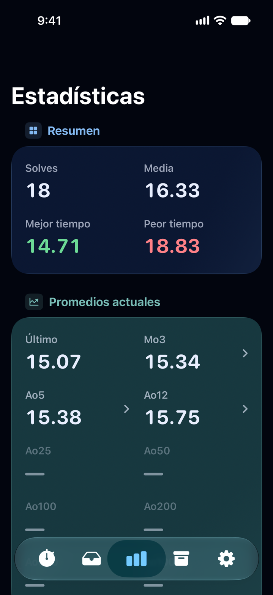
  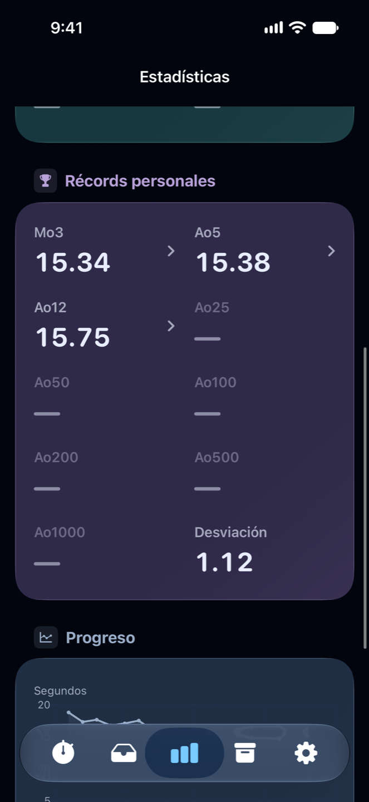
</p>

| Bloque | Qué muestra |
| --- | --- |
| **Resumen** | Número total de resoluciones, media de tiempos válidos, mejor tiempo y peor tiempo válido. |
| **Promedios actuales** | Último tiempo en formato corto, Mo3 y Ao5, Ao12, Ao25, Ao50, Ao100, Ao200, Ao500 y Ao1000. Cada promedio disponible con flecha abre el detalle de sus resoluciones. |
| **Récords personales** | Mejor ventana histórica de cada tamaño y desviación de los tiempos válidos. Las filas con flecha abren sus resoluciones. |
| **Progreso** | Gráfica de tiempos válidos en orden cronológico con Swift Charts. El eje horizontal conserva el número original de resolución, incluso si un DNF deja un hueco. |

Los detalles de los promedios presentan todas las resoluciones de la ventana de más reciente a más antigua, incluidas las que se descartan del cálculo. Cada una conserva su formato largo y su penalización. Los cambios de sesión, penalización o historial se reflejan en los resúmenes y promedios.

### Sesiones

<p align="center">
  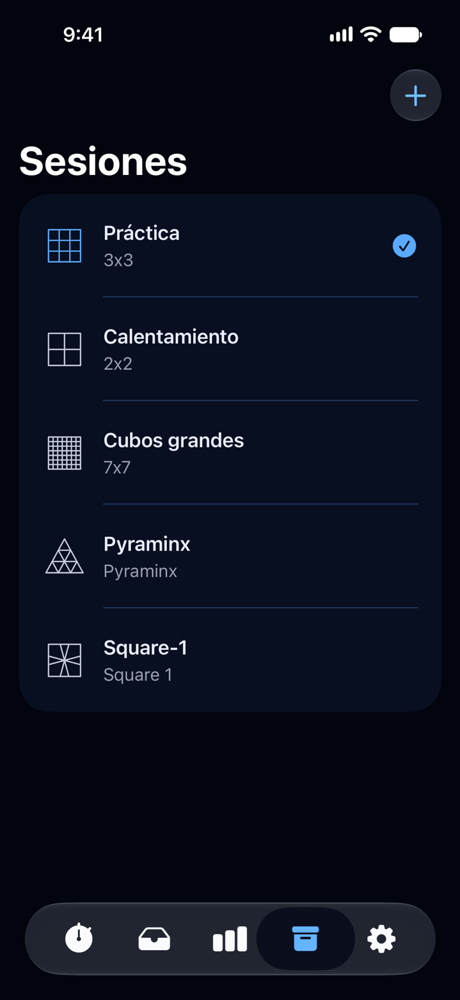
  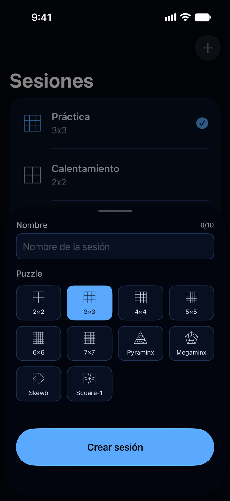
</p>

Toca una fila para activarla. La marca de verificación identifica la sesión activa. Para agregar una, toca **+**, escribe un nombre de hasta diez caracteres y elige el puzzle. En los puzzles con variantes puedes elegir el evento correspondiente. Los espacios en los extremos del nombre se quitan al guardar. Cada fila usa el icono del puzzle de su categoría.

Mantén pulsada una fila para acceder a la opción de eliminar. La app mantiene al menos una sesión y elige una disponible si eliminas la activa.

## Penalizaciones y cálculos

### Formato de una resolución individual

| Penalización | Tiempo original | Valor para estadísticas | Formato corto | Formato largo |
| --- | --- | --- | --- | --- |
| Ninguna | 14.23 s | 14.23 s | `14.23` | `14.23` |
| +2 | 14.23 s | 16.23 s | `16.23+` | `16.23(+2)` |
| DNF | 14.23 s | Sin valor numérico | `DNF` | `14.23(DNF)` |

El formato corto se usa en el cronómetro, sus tiempos recientes y la fila **Último**. El largo aparece en Tiempos y en los desgloses de promedios. Las centésimas del resultado se obtienen truncando la fracción de segundo. El cálculo trabaja con el valor numérico completo. Cambiar o quitar la penalización conserva el tiempo original, la fecha, el identificador y el scramble.

### Fórmulas y casos límite

| Métrica | Regla |
| --- | --- |
| **Solves** | Cuenta todas las resoluciones, incluso DNF. |
| **Media** | Suma los tiempos válidos y divide por su cantidad. Incluye los dos segundos de cada +2 y omite DNF. |
| **Mejor y peor tiempo** | Mínimo y máximo de los tiempos válidos con su penalización +2 si corresponde. Omite DNF en ambos extremos. |
| **Mo3** | Media aritmética de las tres resoluciones más recientes. Basta un DNF para que el resultado sea DNF. |
| **AoN sin DNF** | De las últimas N resoluciones descarta exactamente una mejor y una peor. Divide la suma restante entre N − 2. |
| **AoN con un DNF** | Descarta el DNF como peor y el tiempo válido más bajo como mejor. Divide la suma restante entre N − 2. |
| **AoN con dos o más DNF** | Devuelve DNF en cuanto encuentra el segundo. |
| **Desviación** | Desviación estándar muestral de los tiempos válidos. Divide la suma de diferencias cuadráticas respecto de la media entre la cantidad de válidos menos uno, y toma la raíz cuadrada. Requiere al menos dos tiempos válidos. |

Un promedio sin suficientes resoluciones aparece como `—`. Un promedio inválido se muestra como `DNF`. Los promedios numéricos se muestran sin signo `+`.

Por ejemplo, en una ventana de cinco con `12.00`, `13.00`, `14.00`, `DNF` y `18.00(+2)`, el Ao5 descarta 12.00 y el DNF. La media de 13.00, 14.00 y 18.00 es `15.00`. El Mo3 de esa misma secuencia es `DNF`, mientras que el peor tiempo individual válido es `18.00(+2)`.

Para un récord personal (PB), la app recorre todas las ventanas consecutivas del tamaño solicitado. Escoge el menor resultado numérico y, si hay empate, conserva la primera ventana cronológica. Si todas las ventanas son DNF, conserva la primera como detalle de ese DNF. Un AoN cuesta O(N) y buscar su PB para M resoluciones cuesta O((M − N + 1) × N). Los cálculos están en [funcionesEstadisticas.swift](Funciones/funcionesEstadisticas.swift).

## Ajustes

<p align="center">
  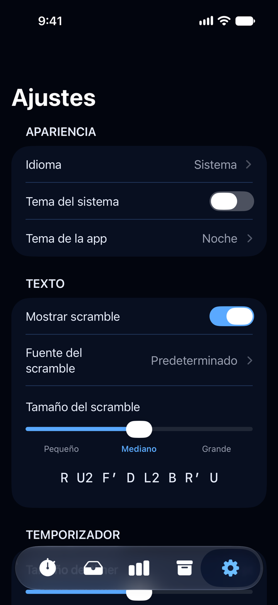
  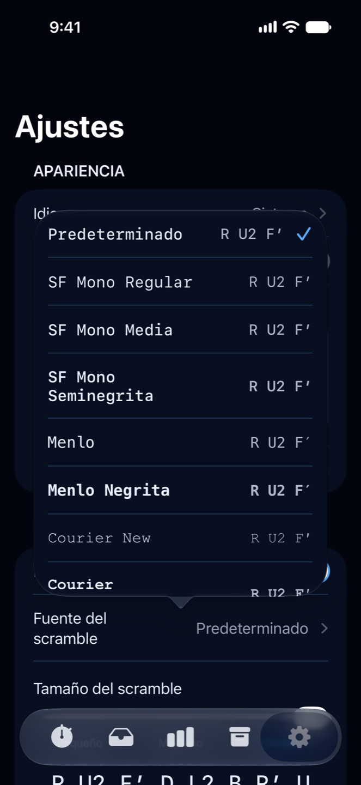
</p>

| Sección | Control | Comportamiento |
| --- | --- | --- |
| **Apariencia** | Tema del sistema | Sigue la preferencia clara u oscura del iPhone. Viene activado. |
| **Apariencia** | Tema de la app | Permite elegir uno de 16 temas cuando el modo del sistema está desactivado. |
| **Texto** | Mostrar scramble | Viene activado. Al desactivarlo, lleva la secuencia al panel del diagrama. |
| **Texto** | Fuente del scramble | Selector emergente con 15 opciones y vista previa. Predeterminado usa los caracteres monoespaciados del sistema. |
| **Texto** | Tamaño del scramble | Pequeño, Mediano o Grande. Sus bases son 15, 19 y 24 pt, y se reducen para puzzles con scrambles largos. Predeterminado es Mediano. |
| **Temporizador** | Fuente del timer | Selector independiente con 15 opciones y vista previa. Predeterminado usa la fuente redondeada del sistema. |
| **Temporizador** | Tamaño del timer | De 40 a 100 pt, en pasos de 1 pt. Predeterminado es 70 pt. |
| **Temporizador** | Mantener para iniciar | Activa la pulsación prolongada. Viene activado. |
| **Temporizador** | Tiempo de espera | De 0.3 a 1.5 s, en pasos de 0.1 s. Predeterminado es 0.5 s. |
| **Temporizador** | Color al estar listo | Verde, azul, amarillo, naranja o morado. Predeterminado es amarillo, con un tono distinto según el modo claro u oscuro. |
| **Acerca de** | Restablecer ajustes | Restaura las preferencias de texto y temporizador y los controles de vista previa. Conserva las sesiones y el tema. |

Los temas disponibles son **Claro**, **Oscuro**, **Noche**, **Bosque**, **Atardecer**, **Cósmico**, **Océano**, **Arena**, **Glaciar**, **Lavanda**, **Aurora**, **Eclipse**, **Sakura**, **Menta**, **Grafito** y **Volcán**. Cada paleta define fondos, texto, acento y colores de contraste para controles como **Crear sesión**. Las fuentes con nombre usan variantes disponibles en iOS y recurren a una fuente del sistema si la variante solicitada falta. El catálogo y sus valores están en [TemaApp.swift](Ajustes/TemaApp.swift) y [AjustesModelo.swift](Ajustes/AjustesModelo.swift).

<details>
<summary>Fuentes disponibles en cada selector</summary>

- **Timer.** Predeterminado, San Francisco, SF Ligera, SF Redondeada fina, SF Mono, New York, DIN Alternate, DIN Condensed, Avenir Next, Avenir Next Media, Avenir Condensada, Futura, Helvetica Neue, Helvetica Fina y Menlo.
- **Scramble.** Predeterminado, SF Mono Regular, SF Mono Media, SF Mono Seminegrita, Menlo, Menlo Negrita, Courier New, Courier New Negrita, Typewriter, Typewriter Compacta, San Francisco, SF Redondeada, Avenir Next, Avenir Compacta y Helvetica Neue.

</details>

Otros controles están visibles con alcance limitado. **Idioma** e **Inspección de 15 s** conservan su selección solo durante la ejecución y carecen de integración con el resto de la app. **Sincronizar con iCloud**, **Exportar** e **Importar** muestran un aviso de disponibilidad futura. La pantalla de licencias en Ajustes es provisional y el inventario está en [THIRD-PARTY-NOTICES.md](THIRD-PARTY-NOTICES.md).

## Arquitectura y recorrido de una resolución

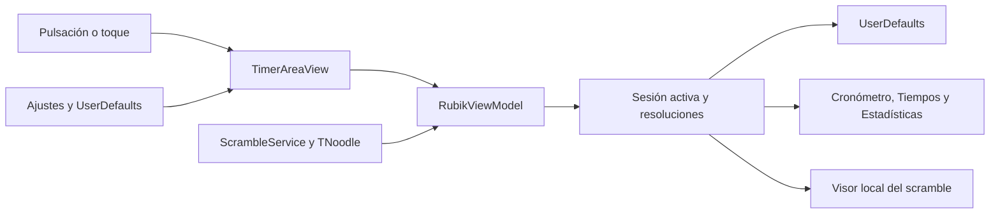

1. [TimeCuber.swift](TimeCuber/TimeCuber.swift) abre [ContentView.swift](TimeCuber/ContentView.swift) en un `WindowGroup`. La raíz crea una instancia de `RubikViewModel` con `@StateObject`, configura la barra de cinco pestañas y aplica el tema mediante el entorno de SwiftUI.
2. [TimerAreaView](Cronometro/TimerAreaView.swift%20.swift) lleva el estado visual de listo con `@GestureState`. Durante la medición, `TimelineView` actualiza los dígitos con la diferencia entre la hora actual y la hora de inicio. La vista desactiva el apagado automático de la pantalla mientras está presente.
3. Al detener, [RubikViewModel](TimeCuber/RubikAppViewModel.swift) mide la duración definitiva, descarta intentos inferiores a 0.01 s y asocia el valor al scramble y la categoría vigentes. Agrega la resolución a la sesión, guarda el historial, actualiza las listas y solicita el siguiente scramble.
4. Al modificar una penalización, el modelo localiza la resolución por UUID dentro de la sesión activa y guarda el cambio. Las vistas observan el mismo `ObservableObject` de `@MainActor` y vuelven a obtener sus métricas a partir de los datos publicados.
5. Los controles funcionales de Ajustes se enlazan con `@AppStorage`. Los controles provisionales viven en un `AjustesEstado` observable, con enlazado local mediante `@Bindable`.

### Mapa del código

| Ruta | Responsabilidad |
| --- | --- |
| [TimeCuber/](TimeCuber/) | Entrada de la app, navegación, estado compartido, modelos, assets y recursos del visor. |
| [Cronometro/](Cronometro/) | Medición, gestos, panel de scramble, resultados recientes y promedios rápidos. |
| [ListaTiempos/](ListaTiempos/) | Ordenamiento y presentación del historial, detalle, penalización y eliminación. |
| [Estadisticas/](Estadisticas/) | Resumen, promedios actuales, récords y gráfica de progreso. |
| [Categorias/](Categorias/) | Creación y selección de sesiones e iconos de los puzzles. |
| [Ajustes/](Ajustes/) | Preferencias, temas, catálogos de fuentes y vistas previas. |
| [Funciones/](Funciones/) | Formatos, cálculos estadísticos y servicios de scramble. |
| [Frameworks/](Frameworks/) | Framework nativo TNoodle para iOS y simulador. |
| [ScrambleEngineBuild/](ScrambleEngineBuild/) | Fuente JavaScript y comando de empaquetado del visor. |

## Modelo de datos y persistencia

[ModeloTiempos.swift](TimeCuber/ModeloTiempos.swift) define `Sesion` como clase codificable con UUID, nombre, categoría y un arreglo de resoluciones. `Tiempo` es una estructura codificable con UUID, segundos originales, fecha, scramble y categoría opcional. La penalización se serializa de forma opcional con la clave `penalizacion`. Se escribe `masDos` o `dnf` cuando corresponde. Un registro antiguo sin dicha clave se interpreta como sin penalización y el diagrama usa la categoría de su sesión si falta en la resolución.

| Claves de `UserDefaults` | Datos |
| --- | --- |
| `savedSesiones` | Arreglo de sesiones codificado como JSON en un valor `Data`, con fechas ISO 8601. |
| `sesionSeleccionadaID` | UUID de la sesión activa. Si falta, se intenta migrar la selección anterior desde `categoriaSeleccionada` y `nombreSeleccionada`. |
| `temaApp`, `temaDelSistema` | Identificador del tema personalizado y preferencia de seguir el tema del sistema. |
| `mantenerParaIniciar`, `tiempoEspera`, `colorListo` | Modo de inicio, duración de la pulsación y señal visual. |
| `mostrarScramble`, `tamanoScramble`, `fuenteScramble` | Visibilidad, tamaño y tipografía del scramble. |
| `tamanoTimer`, `fuenteTimer` | Tamaño y tipografía de los dígitos del cronómetro. |

Las sesiones iniciales son `Standard` (3×3), `Standard2` (2×2), `Standard4` (4×4), `Standard3` (5×5) y `Standard6` (5×5). Se usan cuando falta el historial guardado o falla su decodificación. El almacenamiento es local al contenedor de la app. Los cambios de penalización, el registro y la eliminación de resoluciones actualizan el historial persistido.

## Generación de scrambles y diagramas

### Categorías disponibles

| Puzzle | Eventos |
| --- | --- |
| 2×2 | 2×2 |
| 3×3 | 3×3, una mano (OH), a ciegas (BLD) |
| 4×4 | 4×4, a ciegas (BLD) |
| 5×5 | 5×5, a ciegas (BLD) |
| 6×6 | 6×6 |
| 7×7 | 7×7 |
| Pyraminx | Pyraminx |
| Megaminx | Megaminx |
| Skewb | Skewb |
| Square-1 | Square-1 |

### Motor local

- [ScrambleService](Funciones/Scramble/ScrambleService.swift) mantiene en memoria una cola de hasta cinco scrambles por categoría. Realiza un calentamiento inicial de 2×2 y precarga la categoría activa. Al consumir un scramble, repone la cola en segundo plano y avisa al modelo cuando llega el primer resultado de una cola vacía o falla la generación.
- [TNoodleScrambler](Funciones/Scramble/TNoodleScrambler.swift) traduce cada categoría a un índice de TNoodle y llama a la biblioteca nativa. Cada llamada crea, usa y libera un aislamiento de GraalVM. Un bloqueo serializa las invocaciones. OH reutiliza 3×3, 3×3 BLD usa el generador sin inspección y las variantes BLD de 4×4 y 5×5 reutilizan su generador base.
- [IconoPuzzle](Categorias/IconoPuzzle.swift) dibuja los iconos 2D de sesión mediante `Canvas`. Son siluetas fijas del tipo de puzzle. El visor, en cambio, dibuja el estado que produce un scramble concreto.

### Visor y recuperación de diagramas

[ImagenScrambleView](Funciones/Scramble/ImagenScrambleView.swift) usa un `WKWebView` sin desplazamiento. [ScrambleEngine](Funciones/Scramble/ScrambleEngine.swift) arranca y reutiliza un servidor HTTP que sirve el paquete de recursos en una dirección local `127.0.0.1` y un puerto dinámico. Así WebKit puede cargar los módulos JavaScript empaquetados mediante HTTP local. [viewer.html](TimeCuber/ScrambleEngine/viewer.html) recibe el identificador del puzzle y la secuencia desde Swift y configura el `TwistyPlayer` 2D de cubing.js.

Si el visor tarda demasiado o falla al cargar, muestra un aviso y ofrece **Reintentar**. El detalle de un tiempo reconstruye el diagrama a partir de la categoría y el texto del scramble almacenados con la resolución. El historial conserva la información necesaria para volver a dibujarlo sin almacenar imágenes por separado ni solicitar recursos a un servidor externo.

## Compilación y mantenimiento

### Ejecutar la app

Abre [TimerV3.xcodeproj](TimerV3.xcodeproj) con Xcode compatible con Swift 6. Selecciona el esquema **TimerV3** y un iPhone con iOS 17.4 o posterior. El framework incluido tiene variantes ARM64 para dispositivo y simulador. En Mac con Apple Silicon puedes compilar para el simulador desde la terminal.

```bash
xcodebuild -project TimerV3.xcodeproj -scheme TimerV3 \
  -configuration Debug -destination 'generic/platform=iOS Simulator' \
  ARCHS=arm64 ONLY_ACTIVE_ARCH=YES CODE_SIGNING_ALLOWED=NO build
```

Para ejecutar en un iPhone físico, configura el equipo de firma y, si hace falta, un identificador propio en el target. Xcode usa los recursos del visor y el framework ya incluidos en el repositorio.

### Regenerar el visor

El siguiente comando corresponde al mantenimiento de JavaScript. Requiere Node.js y npm y vuelve a generar el paquete que incorpora Xcode.

```bash
cd ScrambleEngineBuild
npm install
./build.sh
```

La fuente del visor está en [ScrambleEngineBuild/src/viewer.js](ScrambleEngineBuild/src/viewer.js) y la página contenedora está en [TimeCuber/ScrambleEngine/viewer.html](TimeCuber/ScrambleEngine/viewer.html). El manifiesto fija cubing.js en 0.66.1 y usa esbuild para empacar los módulos. [THIRD-PARTY-NOTICES.md](THIRD-PARTY-NOTICES.md) documenta TNoodle, cubing.js y la herramienta usada para preparar la variante de simulador.

### Comprobación de funcionamiento

El proyecto contiene el target de la app. Las capturas del informe se obtuvieron mediante una prueba de interfaz temporal en un iPhone 15 simulado. Para comprobar el flujo completo después de cambiar el código, verifica que una pulsación corta quede en reposo, que un solve nuevo abra otro scramble, que sus detalles reproduzcan el anterior, que alternar +2 y DNF actualice las métricas y que reabrir la app conserve la sesión y sus tiempos.

## Alcance y limitaciones actuales

- La app conserva los tiempos y ajustes en el dispositivo. iCloud y la transferencia JSON están pendientes de integración, junto con los controles de cronómetro indicados en [Ajustes](#ajustes).
- El criterio de orden de Tiempos se conserva durante la ejecución. Al volver a abrir la app, se inicia por fecha.
- El recorte de AoN elimina una resolución por extremo también en ventanas grandes como Ao100 y Ao1000. El mismo criterio se aplica a sus récords personales.
